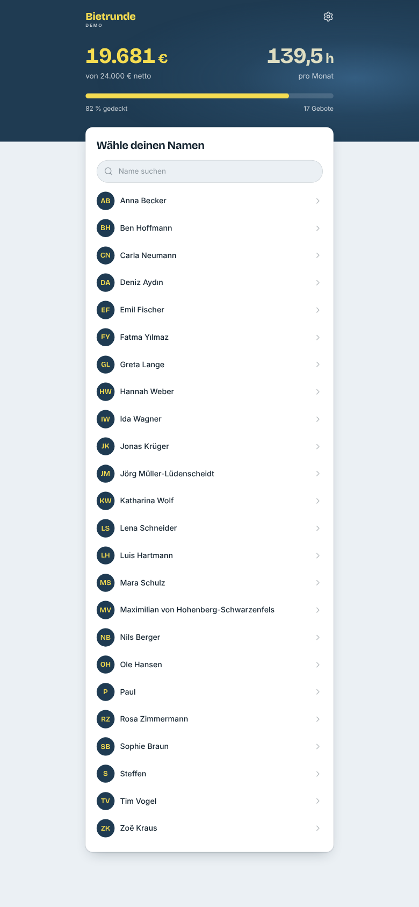
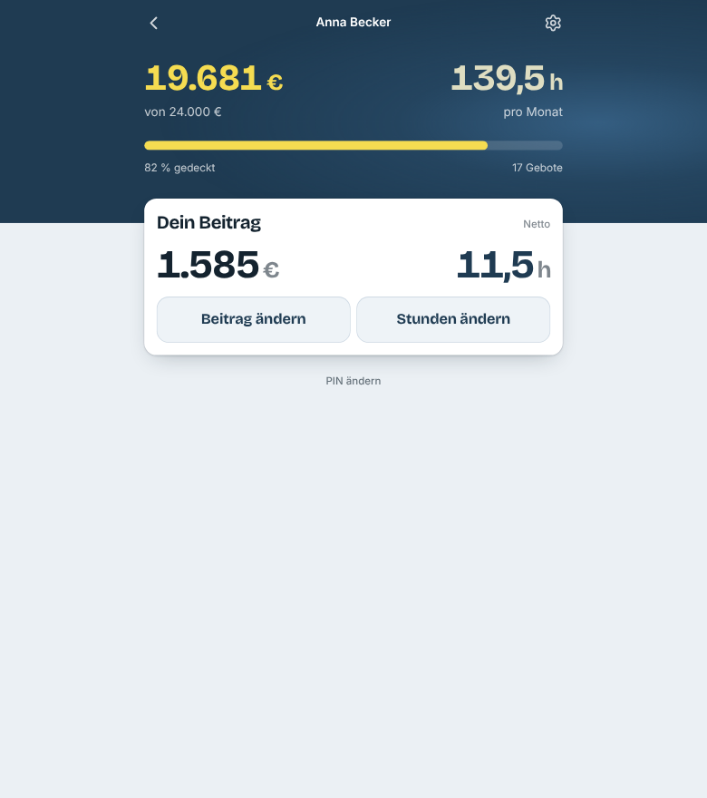
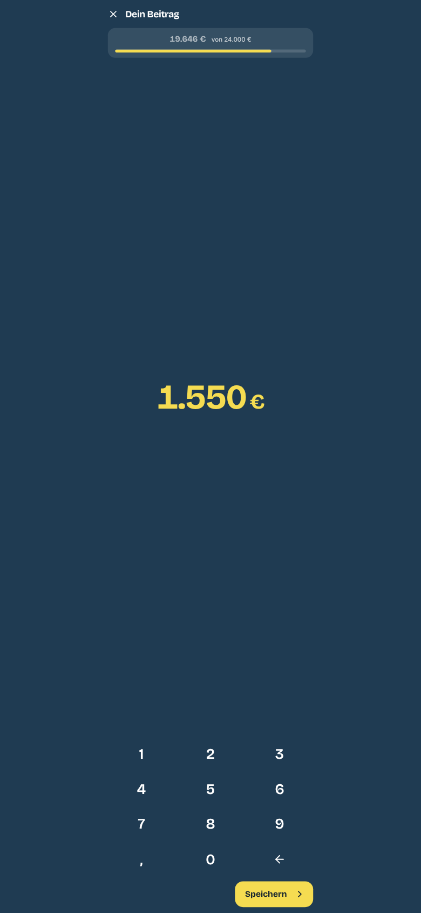
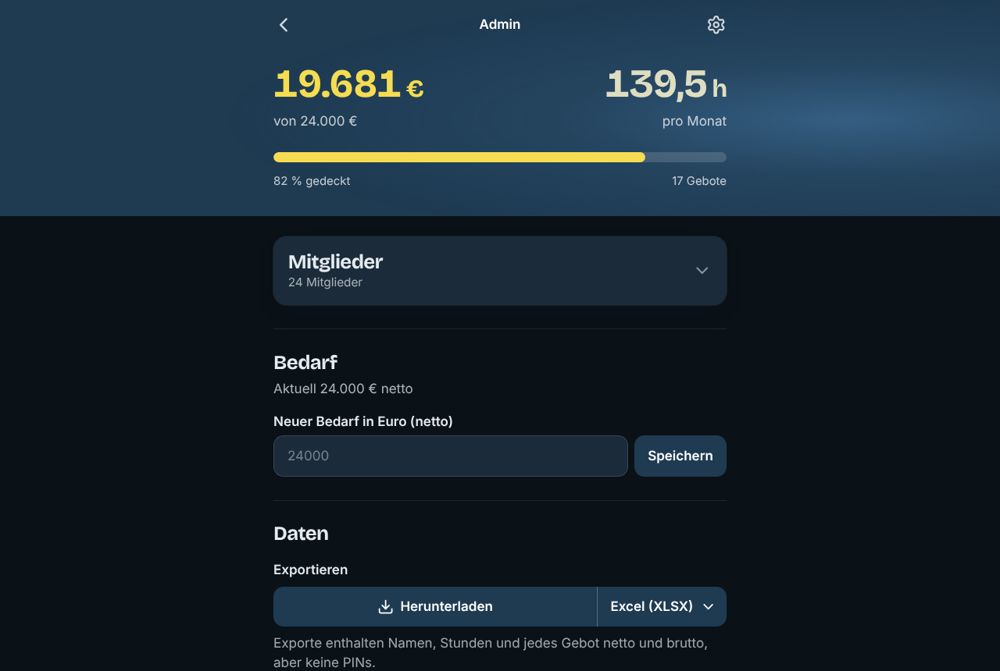

# Bietrunde

[](https://github.com/pbrandl/Contrib-Lean/actions/workflows/ci.yml)

A web app for a *Bietrunde* (pledge round) of a community project: at a members' meeting everybody
picks their name on their phone, logs in with a PIN and pledges a monthly amount and the hours they
can give. The total grows live against the target; who pledged what stays anonymous. Built for and
used by the FRANZ!werk Tübingen (https://franz.uber.space).

<p>
  
  
  
</p>


## Features

- **Members:** pick the name, log in with a 4–8 digit PIN, set the pledge (euros with cents) and the hours per month on a full-screen sheet: the page's own keypad on phones and tablets, the keyboard on computers. A pledge replaces the previous one; 0 withdraws it.
- **Live totals:** sum against the target, progress bar, number of pledges and hours, refreshed every few seconds on every phone.
- **Admin** (`/admin`): add, rename and delete members, set PINs, set the target, export and import (XLSX, CSV or JSON; the import recognises the type by itself). The admin sees no single pledges outside the export.
- **Settings on every page:** light, dark or system appearance; German, English or Spanish; amounts net or gross (19 % VAT). A pledge typed gross is kept exactly as typed.
- **Built for a full room on one WLAN:** login throttling per device, network and account that never locks out the meeting, a write queue with atomic writes, hourly and daily backups, an audit log of every change.
- **Small to run:** one Node process, one JSON file, static files for the pages. No database, no external services.

## Try it

The demo runs entirely in the browser, with 24 made-up members (PIN `1234`, admin PIN `0000`):

```bash
cd frontend
npm ci
npm run build:demo        # writes frontend/build-demo/bietrunde-demo.html, open it in a browser
```

Every [release](https://github.com/pbrandl/Contrib-Lean/releases) has that page attached as well.

## Development

Requirements: Node.js 20 or newer (24 recommended, see `.nvmrc`), npm, and Python 3 for the demo build.

```bash
# Terminal 1: the API on port 3001. The first start creates backend/data/ with the admin PIN 0000.
cd backend
npm ci
node server.js

# Terminal 2: the pages on http://localhost:3000 (admin: /admin), /api goes to the backend.
cd frontend
npm ci
npm start
```

For example data, import `docs/beispieldaten.csv` on the admin page (24 members, PIN `1234`).

Checks (CI runs the same on every push and pull request):

```bash
cd backend && npm test                    # API tests against a fresh temporary database
cd frontend && npm run lint               # ESLint, no warnings allowed
cd frontend && CI=true npm test           # component and unit tests
cd frontend && CI=true npm run build      # production build
```

## Project layout

| Path | What |
|---|---|
| `backend/server.js` | The whole API (Express): login and throttling, sessions, write queue, backups, audit log, import/export |
| `backend/test.js` | API tests, one sequential script against a real server on a random port |
| `backend/set-pin.js` | Sets a PIN directly in the data file (e.g. a lost admin PIN) |
| `frontend/src/` | The pages (React 19, Tailwind 3): `MemberApp.js`, `AdminApp.js`, `AmountSheet.js`, `SettingsPage.js`, shared parts in `ui.js` and `lib.js`, texts in `i18n/` |
| `frontend/src/demo.js` | The API in the browser, for the demo build |
| `frontend/public/.htaccess` | Rewrites and security headers (Content-Security-Policy) for Apache |
| `tools/pin-mail/` | Sends every member their PIN by mail (German) |
| `docs/` | Example data and screenshots |

## Documentation

- [`CLAUDE.md`](CLAUDE.md): architecture, invariants of the write path and the login throttling, and the agreed UI spec. Read it before changing the code; it is written for people and coding agents alike.
- [`CONTRIBUTING.md`](CONTRIBUTING.md): how to work on the code, the checks, dependencies and how a release is made.
- [`DEPLOY.md`](DEPLOY.md) (German): installing a new version on the Uberspace, with the way back.
- [`CHANGELOG.md`](CHANGELOG.md) (German): what each version changed.
- [`SECURITY.md`](SECURITY.md): how to report a vulnerability.

## Releases

A published GitHub release gets two files attached by the [release workflow](.github/workflows/release.yml): `fundraiser-app-vX.Y.Z.zip`, the deploy package `DEPLOY.md` expects, and `bietrunde-demo-vX.Y.Z.html`, the demo page. The steps are in `CONTRIBUTING.md`.

## Operations (FRANZ!werk on the Uberspace)

### Layout on the Uberspace

| Part | Where |
|---|---|
| Backend (Express, no database) | `~/fundraiser-app/backend/server.js`, supervisor service `fundraiser`, port 3001, web backend `/api` |
| Data | `~/fundraiser-app/backend/data/` (see below) |
| Frontend (React + Tailwind) | source in `~/fundraiser-app/frontend/src`, build served by Apache from `~/html` |

#### Data folder

| File | Purpose |
|---|---|
| `database.json` | members (PINs only as scrypt hashes), bids netto (`contributions`), bids typed brutto as typed (`grossBids`), hours per month (`hours`), target netto. Written atomically. |
| `audit.log` | one JSON line per change (bid, hours, PIN change, import, …) and per login, with `rev`, IP address, browser (`ua`) and the first 8 characters of the device id – every bid can be traced to a device. Never contains PINs. |
| `backups/database-YYYY-MM-DD.json` | state before the first change of each day (UTC date), 60 days kept |
| `backups/database-YYYY-MM-DD-HHh.json` | state before the first change of each hour (UTC), 48 hours kept |
| `backups/database-…-before-import.json` | state before every import |
| `session-secret` | signs login sessions. Deleting it logs everybody out. |

### Security model

- PINs are 4–8 digits, stored as scrypt hashes, never sent to the browser, exported or logged.
- Members the admin adds one by one get a random 4-digit start PIN, shown to the admin once. Members created by an import get the PIN from the file, otherwise the shared start PIN 1234 (everybody who knows it can log in to accounts that still use it; members should change it after their first login).
- Login returns a signed session token. Members stay logged in for 30 days, admins until the tab is closed (max. 12 h).
  A member is logged out earlier by "Abmelden", by the back gesture on their own page (on purpose, so nobody stays logged in on a borrowed phone), by any PIN change (it ends all other sessions of that account) and by clearing the browser data or a private window.
  The login is stored per browser: a member who opened the link from the mail inside the mail app's own browser (Gmail, Outlook) and later opens the page in Safari or Chrome has to type the PIN again there.
- Every browser sends a random device id (in the login and as `X-Device` header). After a right PIN it gets a signed "trusted device" credential for that account (180 days, bound to the device id and the current PIN).
- Changing a PIN ends all older sessions of that account and the trusted-device status of all its devices.
- Own device: 5 wrong PINs on one device lock that device for that account (1 min, doubling up to 1 h). Other phones are not affected, also in the same WLAN. Clients without a device id are locked per network instead (IPv4 address or IPv6 /64).
- Per account and network (IPv4 address or IPv6 /64): wrong PINs from devices that are not trusted for the account are limited to 20, then one every 18 minutes. For the admin: 10, then one every 2 hours. An attacker elsewhere therefore only uses up the budget of their own network, never the one of the meeting.
- Per account across all networks, against guessing with many addresses: 100, then 100 a day (admin: 30, then one an hour). This does not apply to the network the admin logged in from in the last 24 hours, i.e. the meeting's WLAN once the admin has logged in there. With a random 4-digit PIN this means about seven weeks on average to guess a member PIN, more than half a year for the admin.
- When a budget is used up, only trusted devices can log in to that account from there until it refills. A trusted device that types 5 wrong PINs in a row counts as new until its next right PIN. Only one PIN check per device and account runs at a time.
- There is no limit per IP address alone, so a whole WLAN behind one address is never blocked (tested with 600 members and 336 typos behind one address).
- A new PIN from the admin lifts all locks of that account. If the admin is locked out on all devices, set a new PIN with `set-pin.js` (see below); the restart clears all locks.
- At an event: log in as admin once on the device you will use (it becomes trusted), and once over the meeting's WLAN at the start (that network becomes exempt from the account-wide limit).
- Locks live in memory; a restart resets them.
- At most 2 PIN checks (logins and new PINs) run at the same time; more wait in a queue where trusted devices and new devices take turns. If the expected wait is over 8 s or more than 200 are waiting, the server answers 503, so a login rush does not slow down the bids. Logins whose page has already given up are skipped.
- Each member can make 50 changes at once, then 10 per second, so a script cannot flood the write queue.
- Request bodies are limited to 16 kB (the import: 1 MB, read only after the admin session was checked).
- The pages send a strict Content-Security-Policy (no inline scripts; `frontend/.env` keeps the build free of them), refuse to be shown in frames of other sites and set `nosniff`, `Referrer-Policy` and `Permissions-Policy` (`frontend/public/.htaccess`). The API sets its own headers.
- All writes go through one queue, and the audit log is written inside it, in the order of the changes. A bid is sent as the new total, not as a step, so a page that gets no answer simply sends it again and nothing is doubled.

### Common tasks

Every command on its own line; never chain `rsync --delete` with other commands (a typo makes the last word its target, and `--delete` empties that folder).

Install a new version: follow `DEPLOY.md`. It builds and tests the new version in a folder of its own, then swaps the folders while the service is stopped for a few seconds; the old folder stays as the way back.

A small change made directly on the server, frontend:

```bash
cd ~/fundraiser-app/frontend
```

```bash
npm run build
```

```bash
rsync -a --delete ~/fundraiser-app/frontend/build/ ~/html/
```

Backend (`npm ci` only when `package-lock.json` changed):

```bash
supervisorctl restart fundraiser
```

Check the security headers of the live site:

```bash
curl -sI https://franz.uber.space/ | grep -iE 'content-security|x-frame|nosniff|referrer|permissions'
```

Run the tests (`node test.js /nonexistent` uses a fresh temporary database; without the argument it uses a temporary copy of `database.json`; the real data is never touched):

```bash
cd ~/fundraiser-app/backend
```

```bash
node test.js /nonexistent
```

Admin PIN lost: set a new one on the Uberspace (replace `4711`; 4 to 8 digits):

```bash
supervisorctl stop fundraiser
```

```bash
cd ~/fundraiser-app/backend
```

```bash
node set-pin.js admin 4711
```

```bash
supervisorctl start fundraiser
```

Restore a backup (pick the file from `ls ~/fundraiser-app/backend/data/backups/`):

```bash
supervisorctl stop fundraiser
```

```bash
cp ~/fundraiser-app/backend/data/backups/database-2026-10-12.json ~/fundraiser-app/backend/data/database.json
```

```bash
supervisorctl start fundraiser
```

## Demo and the live server

The demo build replaces the API with `frontend/src/demo.js`, keeps every visitor's changes in their own browser and uses neutral branding. Do not put it on the live server: next to the real app it would lead visitors to the real member list.

## License

No license has been chosen yet. Until one is added, all rights are reserved by the author.
